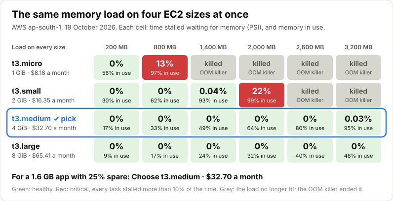

# SysHealth — Find the right instance size for your app

[](https://github.com/Alok-Jadhao/syshealth/actions/workflows/test.yml)

SysHealth tells you **which instance size to buy for your app, and shows the
evidence**. It runs the memory your app needs on several sizes at once, measures
how long programs wait for memory on each (Linux PSI, Pressure Stall
Information), and names the cheapest size that holds your app's peak with room
to spare, in dollars a month. A Flask server collects the agents' samples and
serves a live dashboard; the answer is also one API call away.



**A real run on AWS** ([details below](#experimental-results)): the same load on
four sizes at the same moment. The t3.micro was stalled 13% of the time at 97% in
use, then OOM-killed from 1.4 GB. The t3.small was stalled 22% at 2 GB. The
t3.medium held 3.2 GB at 95% in use and was stalled 0.03% of the time. For a
1.6 GB app with 25% spare, that is **t3.medium at $32.70 a month**. Memory in use
is not memory pressure: 97% and 95% in use look alike, and only one of them was
slow.

### Try it

```bash
npm run dev                   # a simulated four-size fleet at http://127.0.0.1:5000, no AWS
terraform/rightsize.sh --need 1600 --ramp 200:3200 --steps 6 --step-sec 60   # the real run: build, test, report, destroy
./aws.sh up --profile NAME    # or keep a fleet up, and test from its dashboard
```

The first needs only Flask and requests ([below](#preview-it-locally)); the
other two need AWS credentials and Terraform
([below](#run-it-on-aws-one-command-up-one-down)).

### Why not Compute Optimizer, a usage alarm, or Prometheus?

- **AWS Compute Optimizer** recommends a size from at least 30 hours of
  CloudWatch data on instances that are already running, and sees memory only
  as the CloudWatch agent's `mem_used_percent`: how full, not how slow.
  SysHealth answers before you buy, from one test, by how long programs
  actually waited for memory.
- **A usage alarm** ("memory over 80% in use") cannot tell full from slow.
  Above, the t3.micro at 97% in use was stalled 13% of the time, and the
  t3.medium at 95% was stalled 0.03%.
- **Prometheus with node_exporter** already collects memory PSI, and Grafana
  can graph it. If all you need is to *watch* pressure, use them. SysHealth
  does what a monitor cannot, because a monitor only observes:

| | Prometheus + Grafana | SysHealth |
|---|---|---|
| Memory pressure (PSI) over time | Yes | Yes |
| Thresholds for "degraded" and "critical" | You write the rules | Built in, from published production systems ([docs](docs/thresholds.md)) |
| Applies a load, the same on every size at the same moment | No | Yes: peak, ramp, up-and-down, bursts |
| Knows what load caused a reading | No | Yes, every sample carries the test step |
| How much memory each size can hold before your app slows down | No | Yes, from the pressure at each load level |
| Which size to buy, and what it costs | No | Yes: the cheapest size that fits, priced, with what the others would cost |
| Why a machine is under pressure | Raw counters; you work it out | The likely cause in words (swapping, programs filling RAM, files re-read from disk), who holds the memory, and any process that only grows |
| Compares itself with a usage alarm | No | Yes: what "alarm at 80% in use" would have bought instead, and why it would be wrong when it is |
| Your app's own pressure, not just the machine's | Needs cAdvisor and more setup | One setting: `SYSHEALTH_APP=myapp.service`. Tells "raise the container's limit" from "buy a bigger instance" |
| CPU credits on burstable sizes | No | Give your app's average CPU (measured from its cgroup) and each t2/t3/t4g size is priced with the credits it would burn, or ruled out where it would be throttled |
| An AI agent can run the experiment | No | An MCP server: "is a t3.small big enough for my app?" is answered by a test, with the evidence and the limits of the answer ([below](#ask-an-ai-agent-mcp)) |
| Says it in plain words | No | "Choose t3.medium · $32.70 a month. t3.small would save $16.35 a month, but it leaves only 5% spare." |

They also work together: SysHealth serves everything it knows in Prometheus's
format at `GET /metrics`, the states, the cause data and the last test's verdict
included ([below](#with-prometheus)).

---

## Experimental Results

Run on 19 October 2026 on AWS (ap-south-1), with the one command that builds
the fleet, runs the test and destroys it:

```bash
terraform/rightsize.sh --need 1600 --ramp 200:3200 --steps 6 --step-sec 60
```

All four sizes got the same memory load at the same moment, rising from 200 MB
to 3,200 MB in 60-second steps. Each cell shows two numbers: the share of time
the machine was stalled waiting for memory (PSI `some`, averaged over the step),
then the share of its memory in use.

| Load | t3.micro (1 GB) | t3.small (2 GB) | t3.medium (4 GB) | t3.large (8 GB) |
|---|---|---|---|---|
| 200 MB | 0% / 56% | 0% / 31% | 0% / 17% | 0% / 9% |
| 800 MB | **13% / 97%** | 0% / 62% | 0% / 33% | 0% / 17% |
| 1,400 MB | killed | 0.04% / 93% | 0% / 49% | 0% / 25% |
| 2,000 MB | killed | **22% / 99%** | 0% / 64% | 0% / 32% |
| 2,600 MB | killed | killed | 0% / 80% | 0% / 40% |
| 3,200 MB | killed | killed | 0.03% / 95% | 0% / 48% |

Bold marks the step a size could not cope with: it was in the Critical band,
with every task stalled at once for more than 10% of the time
([below](#health-classification)). "Killed": from the next step on, the load no
longer fit in memory and swap, and the OOM killer ended it each time.

**Verdict: t3.medium, $32.70 a month.** It is the smallest size that holds a
1.6 GB app with the 25% spare asked for. The t3.small holds about 1.6 GB, which
leaves only 5% spare. The t3.large copes too, at twice the price. This is the
same answer as the August test, now from a run anyone can repeat with one
command.

**Memory in use is not memory pressure.** At 97% in use, the t3.micro was
stalled 13% of the time; the t3.medium, at 95%, was stalled 0.03%. A usage
alarm at 80% would have fired on the t3.medium at 3,200 MB, and on the t3.small
at 1,400 MB, while neither was slowed down.

**Hold each step for at least 60 seconds.** An earlier run with 45-second steps
put the t3.micro's limit at 1,400 MB instead of 800 MB. At 800 MB it was stalled
9.7% of the time, just under the 10% line.

---

## Architecture

```
EC2 Agent (t3.micro)  ──┐
EC2 Agent (t3.small)  ──┤──► Central Server (Flask :5000)  ◄──  Browser Dashboard
EC2 Agent (t3.medium) ──┤         ▲
EC2 Agent (t3.large)  ──┘         │ Stress trigger (:5001)
                                   └──────────────────────
```

Each agent:
- Reads `/proc/pressure/memory` (PSI `some` and `full`, avg10) and `/proc/vmstat` every 5 seconds
- Classifies health as **HEALTHY / DEGRADED / CRITICAL** against fixed, research-backed thresholds ([below](#health-classification))
- POSTs a JSON payload to the central server
- Runs a control server on port 5001 that runs the load tests the dashboard plans, and stops them

---

## Dashboard

Open `http://YOUR_SERVER_IP:5000` in your browser.

- **One number, explained.** The headline is the share of the last minute that
  programs spent waiting for memory, 0–100%. It sits on a Healthy / Degraded /
  Critical band scale, with a plain-English line under it ("out of every 10
  seconds, programs spent about 1.4 waiting for memory") and what to do about it.
  **What the number means** expands into the three bands.
- Live cards per instance — green dot (online) / grey dot (offline), RAM, and the
  same band scale, so sizes compare at a glance. During a test, a size whose load
  the kernel killed never turns green again: the kill frees its memory, so once
  its reading drops below critical the card says **Ran out of memory** until the
  test ends. Each card also has a **Machine load** line: CPU busy, the load
  average and memory in use. A machine working flat out can still read 0%
  waiting for memory, and the line shows it is busy, not idle
- Memory-pressure graph over time, auto-updating, with the one-minute average
  the state is judged on, and the Degraded (10%) and Critical (40%) lines drawn
  in on every view — they are the same for every size
- **Instance** toggle — one machine on its own, or every size overlaid to
  compare. Colour encodes instance size on a single light-to-dark ramp, so a
  line's shade tells you how big the box is
- **Range** toggle — 5m / 15m / 1h / All — and a table view of the same samples
- **⚡ Load test** — a form for the load your app actually has, run on every
  online instance at the same moment ([below](#load-tests)). The test's load is
  drawn as a track above the graph, so pressure lines up with what caused it
- **Where the memory is** — for one machine: programs, file cache, the
  kernel and free, how much is "in use" the way most dashboards count it, the
  processes holding the most, the **likely cause** of any pressure, and a
  warning for a process that has only grown for minutes, with when the
  machine would run out at that rate ([below](#why-the-likely-cause))
- **Which size to choose** — after a test, the cheapest size that holds your
  app's peak with the room to spare you ask for, priced per month, with a chart
  of pressure against load that shows where each size gives out
  ([below](#right-sizing-which-size-to-buy))

---

## Preview it locally

The dashboard only says anything once several differently-sized machines are
pushing, so there is a demo mode that simulates a four-size fleet — no AWS, no
agents, nothing to configure:

```bash
sudo apt install python3-flask python3-requests    # first time only
npm run dev                                        # or: python3 dev.py
```

On Debian and Ubuntu, `pip install flask` fails with
`externally-managed-environment` — pip is not allowed to write to the system
Python. Install the packaged versions as above, or keep them out of it entirely:

```bash
python3 -m venv .venv
.venv/bin/pip install flask requests
source .venv/bin/activate      # then: npm run dev
```

Then open <http://127.0.0.1:5000>. You get `t3.micro` through `t3.large` under a
repeating load cycle, the **Instance** toggle to compare them, and **Load test**,
which runs a simulated peak or variable test of whatever size you enter.

The pressure values are synthetic and every page says so in a banner. Only the
sensor is faked: each simulated machine turns memory demand into pressure from
its own RAM, then goes through the real `Analyzer`, and tests are planned by the
real `loadtest.py`. So the states, the reasons, the threshold lines and the
load-test results come out of the same code that runs in production.

`npm` is used only as a familiar entry point — the project is Python, and
`package.json` has no dependencies to install.

---

## Run it on AWS: one command up, one down

You need AWS credentials (`aws configure`, or `aws configure --profile NAME`)
and Terraform. Then:

```bash
./aws.sh up --profile NAME    # the dashboard and t3.micro/small/medium/large
./aws.sh down                 # destroy all of it
```

`up` first says which account and region it will use and what that costs
(about $0.19 an hour in Mumbai, the default region), and asks before going on.
It builds the fleet, waits until every size is reporting (about three minutes),
and prints the dashboard's address and token. There is nothing to prepare by
hand:
- **SSH key:** it makes one at `~/.ssh/syshealth_ed25519`.
- **Firewall:** it lets in only this machine's address.
- **Account:** it remembers which account it built in, and `down` refuses to
  run against any other.

While it is up:

```bash
./aws.sh status               # what is running, since when, what it has cost
./aws.sh test --need 1600 --ramp 200:3200 --steps 6 --step-sec 60   # which size to buy
./aws.sh ssh t3.small         # a shell on one machine (or: dashboard)
./aws.sh deploy               # send your local changes to it (or: agents, server)
```

`deploy` copies the files git tracks, as they are in your working tree, to
every machine and restarts them, without rebuilding anything. `git add` a new
file first. Restarting the dashboard empties its graphs, since history is kept
in memory.

`--region` and `--types "t3.small m7i.large"` change where it runs and which
sizes. If you move to another network, run `up` again: it moves the firewall to
your new address.
[`terraform/README.md`](terraform/README.md) has the plain-Terraform route,
costs and design notes.

---

## Quick Start (manual)

### 1. Launch EC2 instances (AWS CLI)

```bash
# Key pairs and security groups are both per region, so set this once.
REGION=ap-south-1

# Create key pair
aws ec2 create-key-pair --region $REGION --key-name syshealth-key \
  --query "KeyMaterial" --output text > syshealth-key.pem
chmod 400 syshealth-key.pem

# Create security group (ports 22, 5000, 5001)
SG_ID=$(aws ec2 create-security-group --region $REGION \
  --group-name syshealth-sg --description "SysHealth" \
  --query "GroupId" --output text)

aws ec2 authorize-security-group-ingress --region $REGION \
  --group-id $SG_ID --ip-permissions \
  "IpProtocol=tcp,FromPort=22,ToPort=22,IpRanges=[{CidrIp=0.0.0.0/0}]" \
  "IpProtocol=tcp,FromPort=5000,ToPort=5000,IpRanges=[{CidrIp=0.0.0.0/0}]" \
  "IpProtocol=tcp,FromPort=5001,ToPort=5001,IpRanges=[{CidrIp=0.0.0.0/0}]"
```

### 2. Set up the central server

```bash
ssh -i syshealth-key.pem ubuntu@YOUR_SERVER_IP

sudo apt update && sudo apt install -y python3-flask python3-requests python3-waitress
git clone https://github.com/Alok-Jadhao/syshealth.git && cd syshealth
export SYSHEALTH_TOKEN=$(python3 -c 'import secrets; print(secrets.token_urlsafe(24))')
echo "$SYSHEALTH_TOKEN"     # the agents and anyone starting a test need it
nohup python3 server.py > server.log 2>&1 &
```

### 3. Set up agents on each EC2 instance

```bash
ssh -i syshealth-key.pem ubuntu@YOUR_AGENT_IP

sudo apt update && sudo apt install -y python3-requests stress
git clone https://github.com/Alok-Jadhao/syshealth.git && cd syshealth

# Point the agent at your server (required: there is no built-in address),
# with the server's token
export SYSHEALTH_SERVER_URL=http://YOUR_SERVER_IP:5000/metrics
export SYSHEALTH_TOKEN=<the server's token>

# Calibrate baseline (60s idle measurement)
python3 syshealth.py calibrate

# Start agent
nohup python3 syshealth.py > agent.log 2>&1 &
```

The instance appears on the dashboard within 5 seconds.

---

## Deploy Script

After changing code locally, send it to the machines you set up above with one
command. Say where they are and give the token; nothing is built in:

```bash
export SERVER=YOUR_SERVER_IP AGENTS="AGENT_IP_1 AGENT_IP_2" SYSHEALTH_TOKEN=<the server's token>

./deploy.sh agents     # the agents only
./deploy.sh server     # the server and dashboard only
./deploy.sh            # both
```

It copies the files git tracks into `~/syshealth` on each machine and restarts
them, with the token, and with the agents pointed at `http://$SERVER:5000/metrics`.
`KEY` names the SSH key if it is not `syshealth-key.pem`. For a fleet built with
`./aws.sh up`, use `./aws.sh deploy` instead.

---

## Health Classification

The number is Linux PSI: the share of time programs were stalled waiting for
memory. 20% means that out of every 10 seconds, 2 were lost waiting, so the work
could have run about 20% faster with enough memory. It measures harm, not usage:
a box can be 90% full and fine.

| State | Condition (one-minute average) | In plain words | Persistence |
|---|---|---|---|
| HEALTHY | `some` < 10% | Under 1 s in every 10 lost to waiting | Immediate |
| DEGRADED | `some` 10–40% | Noticeably slower than with enough memory | 3 consecutive samples (15s) |
| CRITICAL | `some` ≥ 40%, or `full` ≥ 10% | Thrashing; timeouts and OOM kills are next | 3 consecutive samples (15s) |

`some` is the share of time *any* task waited; `full` is the share of time
*every* task did, so nothing got done at all.

The thresholds are absolute: PSI is already normalised to wall-clock time, so
they mean the same on every size. They are taken from systems that act on PSI in
production — Android's lmkd, systemd-oomd, Meta's oomd and the TMO paper (ASPLOS
'22). **[`docs/thresholds.md`](docs/thresholds.md)** has the sources, the
reasoning for each line, and why the old 2×/5×-of-baseline rule was dropped.
The values are constants at the top of `analyzer.py`, and every sample carries
the ones it was judged by, so the dashboard draws whatever was applied.

**Baseline calibration** still runs (`python3 syshealth.py calibrate`) and is
reported as each machine's idle reference, but states no longer depend on it.

---

## REST API

| Method | Endpoint | Description |
|---|---|---|
| GET | `/` | Live dashboard |
| POST | `/metrics` | Agent metric push (token). A sample with a field of the wrong type is turned away with 422 and the field's name, so it cannot break the pages |
| GET | `/metrics` | Everything above for Prometheus to scrape ([below](#with-prometheus)) |
| GET | `/instances` | All instances with online status and latest metrics |
| GET | `/instances/<hostname>/history` | Last 60 samples for one instance |
| GET | `/series` | Every instance's recent history — what the graph reads; `?since=` only what is new |
| GET | `/summary` | Each instance now and over the last hour in a few KB, with its app's measured peak memory and average CPU |
| POST | `/load-plan` | Preview a load test: the plan and the commands, without running it |
| POST | `/run-stress` | Run a load test on all online agents that take tests (token; no body: the old default test) |
| POST | `/stop-stress` | Stop the running load test on all online agents (token) |
| GET | `/report` | Which size to buy, from the last test: `?need_mb=` your app's peak, `?margin=` % spare, `?cpu=` its average vCPUs, `?test_id=` an earlier test |

"(token)": with `SYSHEALTH_TOKEN` set on the server, these need
`Authorization: Bearer <token>` ([below](#who-can-start-a-test)). Reading is
open to anyone who can reach the port.

```bash
# List all instances
curl http://YOUR_SERVER_IP:5000/instances

# The old fixed test: 1.6 GB (2 workers x 800 MB) for 60 s
curl -X POST -H "Authorization: Bearer $SYSHEALTH_TOKEN" http://YOUR_SERVER_IP:5000/run-stress

# A variable test: ramp 200 MB -> 1.6 GB in 5 steps of a minute
curl -X POST http://YOUR_SERVER_IP:5000/run-stress -H "Authorization: Bearer $SYSHEALTH_TOKEN" \
  -H 'Content-Type: application/json' \
  -d '{"mode":"variable","pattern":"ramp","low_mb":200,"high_mb":1600,"steps":5,"step_sec":60,"workers":2}'

curl -X POST -H "Authorization: Bearer $SYSHEALTH_TOKEN" http://YOUR_SERVER_IP:5000/stop-stress

# Which size to buy for an app that peaks at 1.2 GB and averages half a vCPU, keeping 30% spare
curl 'http://YOUR_SERVER_IP:5000/report?need_mb=1200&margin=30&cpu=0.5'
```

---

## Load tests

The load is no longer fixed. Open **⚡ Load test** on the dashboard and describe
your app's memory use. Every online instance runs the same plan at the same
moment.

| Test | Fields | Answers |
|---|---|---|
| **Peak load** | Memory to hold (MB), how long | Can each size take my app at its busiest? |
| **Variable load: ramp up** | Your app's peak, from / to (MB), steps, seconds per step | How much can each size hold before it slows down? |
| **Variable load: up and down** | Same | A day of traffic: does each size recover when load drops? |
| **Variable load: bursts** | Base / spike (MB), how many, seconds each | How does each size take short spikes? |

Before anything runs, the panel previews the plan as a chart, with each
instance's RAM drawn on it. It shows the peak as a share of that RAM ("168% of
t3.micro's memory") and the exact `stress` command each step becomes. While it
runs, a chip in the top bar shows the step and time left, and **Stop test** ends
it everywhere. Afterwards the panel says which size to choose
([below](#right-sizing-which-size-to-buy)) and reports, per instance, the
outcome, how much it holds, the room it leaves, its price, the worst minute and
the sharpest spike.

Each step is one run of `stress --vm <workers> --vm-bytes <MB per worker>M
--vm-keep --timeout <s>s`. A step always lasts its planned time, even if the OOM
killer ends `stress` early, so every size stays in step. The early exit is
counted and reported as "ran out of memory". A size whose readings of the test
stop before the plan ends, without anyone pressing **Stop test**, is reported
as "stopped reporting at step N", so its missing steps are not mistaken for a
finished test.

The plan is built and bounded in one place, `loadtest.py`: up to 16 GB, 16
workers, steps of 10–1800 s, an hour in all. The agent re-checks every plan
before running it, because its control port is on the network.

### Like a real server: background work and extra swap

With the test as the only work on a box, a size jumps from HEALTHY straight to
CRITICAL. PSI is counted per CPU: when the test's processes wait, nothing else
is running, so the whole machine stalls with them, and the whole-machine rule
fires at the same moment DEGRADED would. A real server has other work that keeps
running while one part waits. Two options in the form, the same on every size,
make the test look like that:

- **Background work**: every vCPU kept busy at the lowest priority for the whole
  test (`nice -n 19 stress --cpu <vCPUs>`), as a server's other jobs would. It
  runs whenever the load waits, so the machine is rarely stalled as a whole, and
  a size can be slowed but still working: DEGRADED.
- **Extra swap** (up to 4 GB): the agent adds a swap file when the test starts
  and removes it when the test ends. With the fleet's 512 MB, a size that cannot
  hold the load is killed within seconds and its reading falls. With more, it
  slows down instead, and its card stays CRITICAL while it does. The agent
  checks the disk has room first and keeps 1 GB free.

**Show all three states** fills in the test that does this on a real t3.micro to
t3.large fleet in ap-south-1: a ramp from 2.1 to 2.4 GB in 5 steps of 75 s, 12
workers, background work and 2 GB of extra swap. Started from the button on
23 October 2026, t3.micro was CRITICAL (45-66% waiting), t3.small DEGRADED
(26-29%), and t3.medium and t3.large HEALTHY (0%) from 80 seconds in to the end
of the test, all at 100% CPU, with nothing killed. The first setting, 1.8 to
2.6 GB with 8 workers, kept the micro at 30-36%, just under critical, and showed
the picture for only 30 seconds to two minutes in three runs. Each card names
the background work and the extra swap while the test runs, so the setup is
never mistaken for the machine on its own. The verdict was t3.medium, as
without them.

---

## Right-sizing: which size to buy

The question a load test is run to answer. `rightsize.py` works it out on the
server from the samples the agents already send, so the dashboard and
`GET /report` give the same answer.

1. **Pressure at each load level.** For each size, the average pressure while
   each level was held, skipping the first 10 s of each step while the 10-second
   reading settles. A level where the kernel killed the test counts as failed:
   once `stress` is killed its memory is freed, and the readings alone would
   make the level look fine.
2. **How much each size holds.** The most memory it held while staying under
   the degraded line. Between the last level it held and the first it did not,
   the crossing is interpolated on the pressure. Pressure rises faster than
   linearly with load, so the estimate errs low.
3. **Room to spare.** Your app's peak plus a margin, 25% unless you change it,
   for growth and for the OS cache. A ramp up past your app's peak measures how
   much room each size really leaves; a peak test can only say it held the peak.
4. **The verdict.** The cheapest size that holds the peak plus the margin, and
   what the alternatives would mean: "t3.small would save $16.35 a month, but it
   leaves only 5% spare." It also names cheaper sizes with the same memory
   that the test did not run, usually the same size on another maker's
   processor: "Not tested, with the same 4 GiB: t4g.medium (Graviton) at $16.35
   a month and t3a.medium (AMD) at $17.96." Only a test can say they hold
   your app, and Graviton needs an Arm build of it.

The report also says what a usage alarm (memory over 80% in use, the
usual way) would have bought instead. When the two agree, that is said too.
When they differ, it gives the evidence: "t3.small is 88% in use at your app's
peak, yet its programs waited for memory under 1% of the time."

Your app's peak is asked for on the form (for a peak test it is the memory
held), and it and the margin can be changed afterwards on the panel, or with
`?need_mb=` and `?margin=`: no need to run the test again.

**CPU.** The test loads memory, so it says nothing about CPU, and on the
burstable sizes most often compared (t2, t3, t3a, t4g) CPU has its own price.
Each earns CPU credits at a fixed rate: a t3.micro can keep 0.2 of a vCPU busy
on average for free, a t3.large 0.6. Give your app's average CPU on the panel
("Its average CPU", in vCPUs), or `?cpu=`, or `--cpu`, and each size is judged
on it too:

- **Unlimited mode** (the t3, t3a and t4g default): every vCPU-hour above the
  baseline is billed, $0.05 for t3, $0.04 for t4g, and here $0.05 for t3a too,
  which AWS's price page does not list on its own. That is added to the
  size's monthly price and can change which size is cheapest: an app averaging
  0.9 vCPU adds $25.55 a month to a t3.micro but $10.95 to a t3.large.
- **Standard mode** (the t2 default): above the baseline the CPU is held down
  once saved credits run out, so the size is ruled out.
- Any size with fewer vCPUs than the average plus the margin is ruled out.

The credit rates are AWS's own credit table and its "T2/T3/T4g Unlimited Mode
Pricing", in `pricing.py`. Your app's average is measured for you with
`SYSHEALTH_APP` ([below](#measure-your-app-not-the-whole-machine)).

**Prices** are AWS's on-demand Linux list prices for the region each agent
reports, from `data/prices.json`. The file records the date it was fetched,
and the report shows it. `python3 tools/update_prices.py` refreshes it from
AWS's public price list, with no AWS account needed. For a discounted rate, a
family it does not cover or another cloud, point `SYSHEALTH_PRICES_FILE` at a
JSON file of your own (`{"t3.micro": 0.0104}`, or by region); it always wins.
Agents off EC2 can set `SYSHEALTH_INSTANCE_TYPE` and `SYSHEALTH_INSTANCE_REGION`.

---

## From the command line, or CI

`cli.py` drives any SysHealth server, the demo included, with nothing but the
Python standard library:

```bash
python3 cli.py status                                   # who is reporting, and their state
python3 cli.py run --need 1600 --ramp 200:3200 --steps 6 --step-sec 60
python3 cli.py report --need 1200 --margin 30 --cpu 0.5  # the last test, judged again
python3 cli.py run --peak 1600 --for 120 --expect t3.medium --save report.json
python3 cli.py run --ramp 2100:2400 --steps 5 --step-sec 75 --workers 12 --background --swap 2048
```

`run` starts the test on every instance, shows its progress, then prints the
verdict: the table of sizes, the pick, what the alternatives would cost, and
the usage-alarm comparison. It exits 0 when a size was recommended, 2 when none
fits or the test fell short of the app's need, and 3 when `--expect` named a
different size. That makes it a CI gate: fail the build when the app has
outgrown the size it is deployed on. Ctrl-C stops the test everywhere.
`--dry-run` checks a test without running it. The server is `--server`,
`$SYSHEALTH_URL`, or `http://127.0.0.1:5000`; its token goes in
`$SYSHEALTH_TOKEN` (an environment variable, so it stays out of shell history).
On a fleet from `./aws.sh up`, `./aws.sh test ...` runs it with the address and
token filled in, and saves the report.

**The whole experiment in one command.** `terraform/rightsize.sh` builds a fleet
of the sizes you name, waits for them, runs the test, saves the report and
destroys the fleet again, also on failure or Ctrl-C
([terraform/README.md](terraform/README.md#or-all-of-it-in-one-command)):

```bash
cd terraform && ./rightsize.sh --need 1600 --ramp 200:3200 --steps 6 --step-sec 60
```

---

## Why: the likely cause

PSI says how much time programs lost waiting for memory, not why, and the fix
depends on why. Each agent reads the kernel's own evidence (`/proc/meminfo`,
`/proc/vmstat`, `/proc/<pid>/status`) and `diagnose.py` turns it into words:

| Cause | Evidence | What to do |
|---|---|---|
| A memory limit | Pressure while a quarter of RAM or more is still available: something is held to its own limit (a container, a unit's `MemoryMax`) | Raise that limit; [watch the app](#measure-your-app-not-the-whole-machine) |
| Swapping | Memory read back from swap, 1 MB/s or more | A size with more RAM; more swap only hides it |
| Programs fill RAM | Recently dropped file pages read back from disk, 1 MB/s or more, with programs holding 70%+ of RAM | A size with more RAM, or make the app hold less |
| Files do not fit | The same re-reading, while programs hold less | More RAM for the cache, or read fewer files at once |
| Reclaim | Programs stopping to free memory before they can get more | If it lasts, more RAM |

A cause is given only while there is pressure to explain. Separately, a process
whose memory has only grown for five minutes or more, by 100 MB and 20% at
least, is called out with the time until the machine would run out at that
rate. The load test's own `stress` is never counted.

Stock EC2 images have no swap, so there the second row is the usual one:
programs fill RAM, and the kernel keeps dropping and re-reading the files they
run from. This project's Terraform gives each agent 512 MB of swap
(`swap_mb`), so on its fleet the first row appears too once that fills.

Each agent also reports CPU and disk I/O pressure, shown beside the memory
breakdown. States go by memory alone; the other two are context, for example
when re-reading files from disk costs more in I/O waits than it shows as
memory pressure.

It reports how busy the machine is too (`cpu` in each sample): the share of CPU
time not idle since its last push, from `/proc/stat`, and the 1-minute load
average, as `uptime` shows it. Busy is not short of memory. Running a language
model on the fleet (Gemma 4 in llama.cpp, which works the CPU hard), t3.medium
had 80% of its memory in use, yet nothing waited for memory and all 39 requests
were answered. Without this line its card read 0% and looked idle.

---

## Measure your app, not the whole machine

The machine's pressure counts every task on it: the agent, the OS, a load
test. Name your app and the agent also reads its own cgroup (with
`SYSHEALTH_SERVER_URL` and `SYSHEALTH_TOKEN` set as in the Quick Start):

```bash
SYSHEALTH_APP=myapp.service python3 syshealth.py         # a systemd unit
SYSHEALTH_APP=system.slice/docker-<id>.scope python3 syshealth.py   # a container
```

A unit name, a path under `/sys/fs/cgroup`, or a full path all work; it needs
cgroup v2, the default on current distributions. The dashboard gains a
**Your app** tile: the share of time tasks *in the app* waited for memory, what
it holds against its memory limit (a container's, or systemd's `MemoryMax`),
and how often the kernel has killed something in it for going over. When the
app is waiting, it says whose fault that is:

- **Its own limit**: the app is at 90% or more of its limit while a quarter of
  the machine's RAM or more is still available. Raise the limit; a bigger
  instance would not help.
- **The machine**: the app is well under its limit, but the machine is short.
  A bigger instance, or less else running beside it.
- **Both**, when the app is at its limit and the machine is short too.
- **A limit above it**: the app is under its own limit and the machine has
  room, so the group it runs in (a pod, a systemd slice) is the likely cap.

That is the decision for a container's memory limit, made the same way as the
instance size: by whether anything waits, not by how full it looks.

Whose fault it is gets judged by how much memory the machine has available, not
by the machine's pressure, and that was learned by measuring. A process held to
150 MB that kept 180 MB in use, on a laptop with gigabytes free: its own cgroup
waited 14–31% of the time, and the machine-wide figure rose too, to 10–22%. The
kernel counts a container's waits at its own limit in the machine's pressure
as well. So the machine-level diagnosis has a matching cause: pressure while a
quarter of RAM or more is still available is put down to a limit, not to the
machine running out.

In the demo, the app runs in a container capped at 512 MB on the t3.large. When
the background load reaches it, the machine stays healthy and the app tile
does not.

The agent also reads the app's CPU from the same cgroup (`cpu.stat`), in vCPUs
kept busy. `GET /summary` (and the MCP server's `fleet_status`) gives its
average and peak over the last hour beside its peak memory: the two numbers to
judge sizes against.

**On a production machine, watch only.** Set `SYSHEALTH_CONTROL=off` there: the
agent reports as usual but opens no control port and never takes a load test,
and the server skips it when one starts. Measure the app where it really runs,
then test the sizes on a fleet built for that.

---

## Who can start a test

A load test fills memory on every machine that takes one, so starting one is
guarded. Set the same `SYSHEALTH_TOKEN` on the server and every agent:

- agents send it with every push, and the server drops pushes without it;
- the server wants it to start or stop a test, and passes it on to each
  agent's control port (5001), which refuses anything without it;
- the dashboard asks for it the first time you press **Start**, and keeps it
  in that browser only; `cli.py` and the MCP server read `$SYSHEALTH_TOKEN`.

`terraform/` makes one for each fleet (`terraform output -raw token`), and
`rightsize.sh` uses it for you. Without a token nothing is checked, as before,
and the agent says so when it starts; the security groups in `terraform/` then
remain the only guard. Reading (the dashboard, `/series`, `/report`,
`/metrics`) stays open to anyone who can reach port 5000.

---

## Ask an AI agent (MCP)

`mcp_server.py` lets an AI agent (any client that speaks the Model Context
Protocol) run the experiment, not just read a graph. Add it to the agent's MCP
servers; most clients take an entry like this (the file it goes in varies):

```json
{
  "mcpServers": {
    "syshealth": {
      "command": "python3",
      "args": ["/path/to/syshealth/mcp_server.py"],
      "env": {
        "SYSHEALTH_URL": "http://YOUR_SERVER_IP:5000",
        "SYSHEALTH_TOKEN": "<token>"
      }
    }
  }
}
```

Then ask: *"Is a t3.small big enough for my app? Run a ramp test if you need
to."* With `npm run dev` running, leave out the variables and it uses the demo.

| Tool | Does |
|---|---|
| `fleet_status` | Each machine's state, why it is under pressure, what is growing, and its app's measured peak memory and average CPU |
| `plan_load_test` | Checks a test and says how long it takes and which machines run it; runs nothing |
| `start_load_test` | Starts it (marked destructive: the agent should ask first) |
| `stop_load_test` | Stops it |
| `rightsize_report` | Which size to buy and its price, the evidence (pressure at each load level), what a usage alarm would pick, and the limits of the answer |

Every answer comes as readable text and as structured data. The limits are
part of it: the load is synthetic, capacity between levels is interpolated and
errs low, CPU is worked out rather than measured, prices are list prices. An
agent passes those on instead of overstating the result. Standard library
only, like `cli.py`; checked with the official MCP Python SDK's client.

---

## With Prometheus

The server answers `GET /metrics` in Prometheus's text format (agents keep
`POST`ing to the same path). Point a scrape job at it:

```yaml
scrape_configs:
  - job_name: syshealth
    static_configs:
      - targets: ["YOUR_SERVER_IP:5000"]
```

| Metric | What it is |
|---|---|
| `syshealth_memory_waiting_ratio`, `_minute_ratio`, `syshealth_memory_stalled_ratio` | PSI `some` (10 s and the minute states are judged on) and `full`, as 0–1 |
| `syshealth_state{state=…}` | 1 for the state each machine is in |
| `syshealth_threshold_ratio{line=…}` | Where each state begins, so alerts can use the same lines |
| `syshealth_cpu_waiting_ratio`, `syshealth_io_waiting_ratio`, `syshealth_io_stalled_ratio` | CPU and disk I/O pressure |
| `syshealth_memory_bytes{part=…}`, `syshealth_memory_in_use_ratio`, `syshealth_swap_used_bytes` | Where the RAM is |
| `syshealth_load_test_bytes` | The memory a running test asks for, 0 when none runs |
| `syshealth_capacity_bytes{kind=…}`, `syshealth_recommended`, `syshealth_price_usd_per_hour`, `syshealth_app_need_bytes` | The last finished test's verdict, per size |
| `syshealth_app_memory_waiting_ratio`, `_stalled_ratio`, `syshealth_app_memory_bytes`, `_limit_bytes`, `syshealth_app_oom_kills_total` | The app's own cgroup, with `SYSHEALTH_APP` |

Every series carries `hostname`, `instance_type`, `instance_id` and `region`.
Names follow Prometheus conventions (bytes, 0–1 ratios); "waiting" and
"stalled" are PSI's `some` and `full`, as in node_exporter.

---

## Project Structure

```
syshealth/
├── server.py          # Flask central server + REST API
├── schema.py          # What a pushed sample may contain; the server checks each push against it
├── syshealth.py       # Agent: collector, analyzer, control server, push client
├── analyzer.py        # Sliding-window PSI classifier, thresholds at the top
├── collector.py       # Reads /proc/pressure/memory (some + full), /proc/vmstat, /proc/meminfo
├── loadtest.py        # Load-test plans: built from the form, checked by the agent
├── rightsize.py       # What a test says each size holds, and which size to buy
├── diagnose.py        # Where the memory is, the likely cause, growing processes
├── prometheus.py      # GET /metrics in Prometheus's text format
├── cli.py             # Run a test and print the verdict; exit codes for CI
├── mcp_server.py      # The same for AI agents: MCP over stdio
├── pricing.py         # What each size costs, from data/prices.json; burstable CPU credits
├── instance.py        # Instance type, id and region via IMDSv2, so sizes can be compared
├── reporter.py        # Local stdout logging
├── dev.py             # Local preview: simulated four-size fleet (npm run dev)
├── aws.sh             # The fleet on AWS: up, down, status, test, ssh, deploy
├── deploy.sh          # Deploy to EC2 instances you launched by hand
├── templates/
│   └── index.html     # Dashboard markup
├── static/
│   ├── css/dashboard.css
│   └── js/dashboard.js   # Pressure graph and load-test panel, inline SVG — no libraries
├── data/
│   └── prices.json    # AWS on-demand list prices, dated (tools/update_prices.py)
├── tools/
│   └── update_prices.py  # Refresh data/prices.json from AWS's public price list
├── tests/             # python3 -m unittest discover -s tests  (or npm test); CI runs them
├── requirements.txt   # flask, requests, waitress
├── docs/
│   ├── thresholds.md  # What the number means; the research behind each threshold
│   ├── img/real-run-2026-10-19.svg  # The picture at the top, from the real run's report
│   └── make_result_figure.py        # Draws it: python3 docs/make_result_figure.py REPORT.json
└── terraform/         # Dashboard + one instance per size, in one apply
    ├── check.sh       # Which sizes are reporting, and why one is not
    ├── common.sh      # Shared by aws.sh, rightsize.sh and deploy.sh
    └── rightsize.sh   # Build, test, report and destroy, in one command
```

---

## Requirements

- Python 3.10+ (CI runs 3.12, Ubuntu 24.04's, and 3.14)
- Flask, requests and waitress: `sudo apt install python3-flask python3-requests
  python3-waitress`, or `pip install -r requirements.txt` in a virtualenv.
  Without waitress the server falls back to Flask's development server, and
  says so.
- Linux kernel ≥ 4.20 (PSI support)
- `stress` package on agent instances (`sudo apt install stress`)
- Node ≥ 18 only if you want `npm run dev` — `python3 dev.py` is the same thing
- Terraform ≥ 1.3 only if you use `terraform/`

---

## Tech Stack

Python · Flask · waitress · Linux PSI · vmstat · AWS EC2 · Terraform · Bash

The graph is hand-written inline SVG with no charting library and no build step,
so the dashboard loads with nothing fetched from a CDN.
